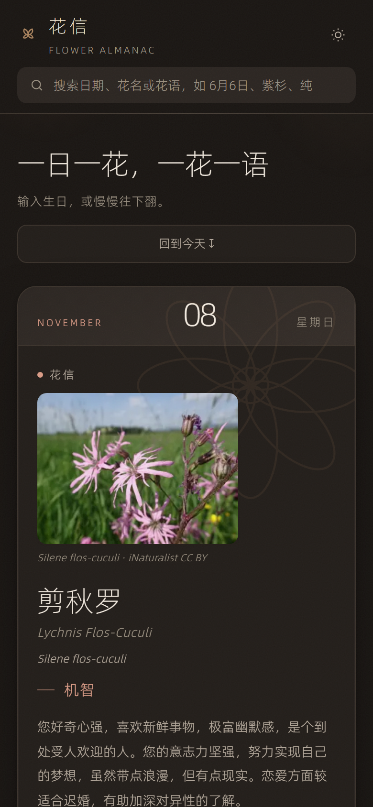

# 花信 · Flower Almanac

一日一花，一花一语。366 天，每天两朵花——**花信**与**圣人花历**两套各自流传的花历，同一天配的花几乎从不相同。

全部内容装在一个 `index.html` 里：10.3 MiB，零依赖，零构建，零外部请求。双击就能看，断网也能看。

[](./index.html)
[](#)
[](#)
[](./LICENSE)

## 在线

https://bigdog2712.github.io/huaxin-flower-almanac/


| 某一天：两套花历并置 | 手机端 |
| --- | --- |
|  |  |

## 这是什么

输入生日，或者慢慢往下翻。每天一屏：花名、英文名、拉丁学名、花语、花占卜、花箴言；点开还有第二套花历——那天纪念的圣人、典故、花语释义、植物志。两套没有共同来源，所以分两段各自成篇，谁也不并进谁里。

一年 366 天（含 2 月 29 日），两套各 366 篇，共 732 篇正文。

## 特性

| | |
| --- | --- |
| **单文件离线** | 图片、字体全部 base64 内联。全文唯一一个 URL 是 SVG 命名空间 `http://www.w3.org/2000/svg`，除此之外一个外部请求都不发——没有 CDN、没有字体服务、没有统计脚本。 |
| **两套花历并置** | 花信（花语 / 花占卜 / 花箴言）与圣人花历（圣人与典故 / 花语释义 / 植物志）分两段，段头严格同构，不分主次。 |
| **605 张实拍配图** | 560 个物种，按拉丁学名从 iNaturalist 开放数据逐种取图，图注即出处与许可（如 `Silene flos-cuculi · iNaturalist CC BY`）。 |
| **搜索** | 日期、花名、花语都能搜，带联想建议；`/` 键直接聚焦搜索框。 |
| **深链接** | `#6-6` 直达 6 月 6 日，地址栏随打开的日子变化，可以直接把某一天发给别人。 |
| **深浅两色** | 默认跟随系统 `prefers-color-scheme`，右上角可手动切换，选择存 `localStorage`。 |
| **细体排版** | 阿里巴巴普惠体 3.0，只取 Thin(100) 与 Light(300) 两个字重并按实际用字子集化内联。层级靠字号、字距、颜色和留白，不靠字重——因为中间没嵌 400/500/600，任何 `font-weight:600` 都会变成浏览器的合成假粗。 |
| **无障碍** | 弹窗带 `role="dialog"` / `aria-modal` / 焦点回收，`Esc` 关闭，左右方向键翻日；尊重 `prefers-reduced-motion`。 |

## 打开

```bash
git clone https://github.com/BigDog2712/huaxin-flower-almanac.git
cd huaxin-flower-almanac
# 直接双击 index.html 即可，不需要起服务
```

起本地服务也一样（`file://` 之外没有任何区别，页面不读 `fetch`、不读 `localStorage` 以外的东西）：

```bash
python -m http.server 8000   # http://localhost:8000
```

部署到 GitHub Pages：仓库 Settings → Pages → Source 选 `main` 分支 `/ (root)`，没有构建步骤。

## 目录结构

```
huaxin-flower-almanac/
├── index.html        # 全部：样式、数据、图片、字体、脚本
├── README.md
├── LICENSE           # 代码 MIT
├── NOTICE.md         # 图片与文本的来源、许可、注意事项
├── 更新日志.md        # 每次改动记一行
└── docs/             # README 用的预览图
```

## 数据与素材

| 类别 | 来源 | 许可 |
| --- | --- | --- |
| 花信 · 花语 / 花占卜 / 花箴言 | 橘园论坛转帖本《365 天生日花语》366 日；正文另与占星网「生日花语」专栏逐条互校，异文择善而从 | 原样转录，本站不主张权利 |
| 圣人花历 · 圣人与典故 / 花语释义 / 植物志 | 生日书（shengrishu.bmcbx.com）366 日逐页收录，保留原页三段结构；花名与学名以「366 朵生日花完整表」交叉校验，疑难条目参《中国植物志》核定科属与花期 | 原样转录，本站不主张权利 |
| 配图 | iNaturalist 开放数据，按拉丁学名逐种取该物种实拍照片 | CC0 18 · PD 3 · CC BY 75 · CC BY-SA 32 · CC BY-NC 375 · CC BY-NC-SA 44 · CC BY-ND 1 · CC BY-NC-ND 12 |
| 字体 | 阿里巴巴普惠体 3.0（Alibaba PuHuiTi），按页面实际用字子集化 | 依字体原许可免费商用 |

细节与注意事项见 [NOTICE.md](./NOTICE.md)。**图片含大量 CC BY-NC 条目：本项目整体仅限非商业使用。**

## 取舍

写的时候定下的几条，文件里都留了注释（`[判据]` 可验证、`[偏好]` 是取舍、`[鲁棒性]` 是防御）：

- **10.3 MiB 单文件是自觉的代价。** 换来的是双击即用、断网可用、扔进任何静态托管都不用配环境。代价是首屏要下完整个文件——所以没做图片懒加载，因为拆出去就要起服务、要处理路径，就不再是「一个文件」了。
- **配图按物种取，不按品种取。** 所以图里的花色未必与题中色名一致（比如题写「白」而照片是粉）。要准确到品种，得换图源。
- **两套花历平权。** `--a-bg` 与 `--b-bg` 的 L\* 必须相等（现均 0.855，差 0.0007）——明度不等就是在暗示重要性不等。
- **照片滤镜只走 `--img-filter` 一个变量。** 组件里不许出现第二个 `filter:`，否则改一处忘一处，两段照片色温不一致。

## 许可

代码以 [MIT](./LICENSE) 发布。第三方图片与文本另有其许可，见 [NOTICE.md](./NOTICE.md)——尤其注意配图中的 CC BY-NC 与 ND 条目。

## 更新日志

见 [更新日志.md](./更新日志.md)。
